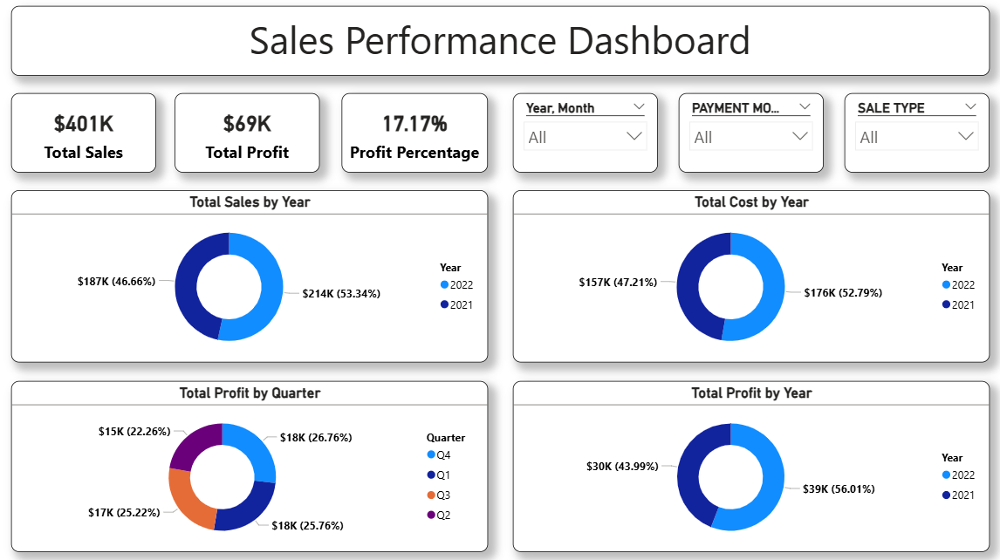

# Sales Performance Dashboard

An independent Power BI practice project represented by a PBIX report and four screenshot exports. The repository does not include the data or database used by the report, so its numerical outputs and business claims are not independently reproducible here. This is not a client engagement.

## Project files

- [Power BI report](outputs/Sales%20Performance%20Dashboard.pbix)
- Dashboard screenshots: [Overview](outputs/Overview.png.png), [Sales performance](outputs/Sales-Performance.png.png), [Product analysis](outputs/Product-Analysis.png.png), and [Category analysis](outputs/Category-Analysis.png.png)
- [Power BI technical guide](docs/power_bi_technical_guide.md)
- [SQL and Power Query examples](scripts/README.md)
- [Business insights notes](docs/business_insights.md.txt) — starter notes; numerical claims are unverified

## Dashboard preview

The screenshot filenames suggest overview, sales, product, and category views. The report model and calculations have not been independently inspected.

## Data and reproducibility

No dataset, database dump, database creation or loading script, or dataset citation is included. The SQL and Power Query documentation refers to tables and server settings that are not provided here. The technical guide and saved insight notes are documentation artifacts, not proof that the described transformations or metrics were executed and validated.

The README previously claimed a multi-region 2021–2022 retail database, 20+ KPIs, automated refresh, and specific growth, revenue-share, and margin results. Those claims are not supported by reproducible source data in this repository and are not reported here. No business impact or operational recommendation is claimed.

## Open the report

Download the PBIX and open it in Power BI Desktop. Reproducing or refreshing its figures requires the original data source and verified connection details, which are not documented in this repository.

## Project status

Power BI practice dashboard with static visual exports. Dataset provenance, model and measure documentation, source access, and a clean refresh process need to be established before interpreting its figures as evidence.
